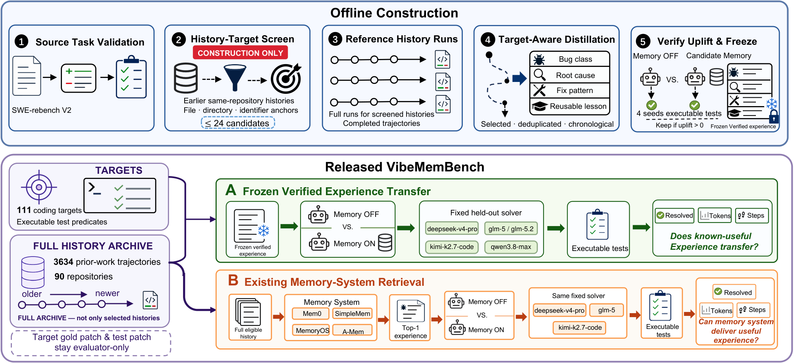
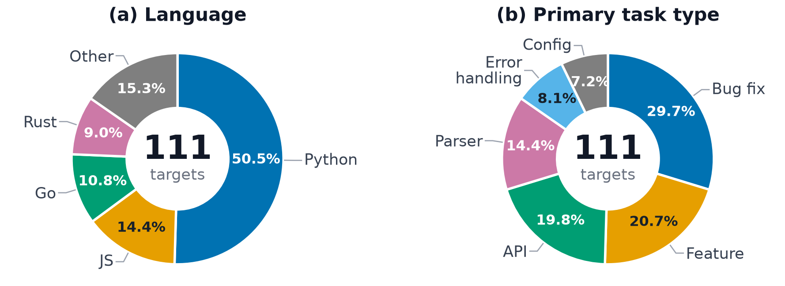

<div align="center">

# VibeMemBench

**Evaluating memory systems for coding agents on real repository coding tasks.**

[](https://www.python.org/)
[](https://github.com/SWE-agent/mini-swe-agent)
[](#the-dataset)
[](#the-dataset)
[](#the-dataset)
[](https://arxiv.org/abs/2609.23570)
[](#the-dataset) <!-- TODO: real Hugging Face dataset link once it is public -->
[](LICENSE)
[](https://github.com/AlibabaResearch/DAMO-ConvAI/tree/main/VibeMemBench)

**English** | [简体中文](README_zh.md)

</div>

---

Coding agents work on real repository tasks, and persistent memory systems promise to reuse
experience across them. VibeMemBench tests whether that experience actually improves executable
repository work. It pairs two runs of the same task under one fixed agent, tools, sandbox, and
budget. Only the memory condition changes. Executable tests decide whether the task is resolved.

The benchmark holds **111 coding targets** from **90 SWE-rebench V2 repositories**, backed by
**3,634 history trajectories** from the same repositories. Each target is kept only when injected
history experience improves its executable outcome in a reference setting, so every target carries
a prior experience whose usefulness is verified by execution.

<p align="center">
  
</p>
<p align="center"><em>Overview. Top: offline construction of the frozen verified experience. Bottom: the two released evaluation tracks.</em></p>

> **Headline finding.** Frozen verified experience raises task resolution on four of five held-out
> solvers by 1.1 to 4.5 points and lowers agent steps on all five. Yet when four existing memory
> systems must build and retrieve experience from the same history, eleven of twelve solver and
> system pairings fail to beat the matched memory-off baseline. The gap is between the useful
> experience that repository history holds and the experience that existing memory systems deliver.

## Contents

- [What this repository ships](#what-this-repository-ships)
- [Repository layout](#repository-layout)
- [Quick start](#quick-start)
- [The dataset](#the-dataset)
- [The evaluation pipeline](#the-evaluation-pipeline)
- [Plug in your own memory system](#plug-in-your-own-memory-system)
- [Main results](#main-results)
- [Acknowledgements](#acknowledgements)
- [Paper](#paper)
- [Citation](#citation)

## What this repository ships

VibeMemBench has two parts, and this repository ships both.

| Part | Where | Role |
| --- | --- | --- |
| **Dataset** | [`benchmark/`](benchmark/) | The 111 targets and the 3,634 history trajectories. Git ignored, distributed through Hugging Face. |
| **Evaluation harness** | [`scripts/`](scripts/) | The three stage pipeline that plugs in a memory system, runs the fixed agent, and scores the result. |

The agent is [mini-swe-agent](https://github.com/SWE-agent/mini-swe-agent). It is not shipped here.
Install it at the pinned commit `bc85a456` with the command in [Quick start](#quick-start) so every
run reproduces. The scoring logic is the SWE-rebench evaluator, vendored under
[`scripts/vendor/`](scripts/vendor/).

## Repository layout

```
VibeMemBench/
├── README.md                 # this file
├── README_zh.md              # the Chinese version
├── LICENSE                   # Apache 2.0
├── .env.example              # copy to .env and fill in the model endpoint
├── assets/                   # the figures shown in this README
├── benchmark/                # the dataset, git ignored, ships via Hugging Face
│   ├── README.md             # the dataset card
│   ├── test.parquet          # the 111 targets, in SWE-bench format
│   └── history/              # 3634 trajectories, grouped by language
├── scripts/
│   ├── CONTRACT.md           # the integrator contract (English)
│   ├── CONTRACT_zh.md        # the integrator contract (Chinese)
│   ├── memory_interface.py   # the MemorySystem ABC and the three data classes
│   ├── memory_systems/       # one file per memory system, discovered by file name
│   │   └── demo.py           # the worked example, EchoMemorySystem
│   ├── run_memory.py         # stage 1: build memory, then search it
│   ├── run_agent.py          # stage 2: run the agent with the memory injected
│   ├── run_eval.py           # stage 3: score the runs
│   ├── docker_pool.py        # image lifecycle shared by stage 2 and stage 3
│   └── vendor/               # the SWE-rebench evaluator, vendored
└── outputs/                  # run outputs, git ignored
```

## Quick start

**1. Get the code.**

VibeMemBench lives inside the [DAMO-ConvAI](https://github.com/AlibabaResearch/DAMO-ConvAI) repo
under [`VibeMemBench/`](https://github.com/AlibabaResearch/DAMO-ConvAI/tree/main/VibeMemBench). Use a sparse checkout to pull only this folder.

```bash
git clone --filter=blob:none --sparse https://github.com/AlibabaResearch/DAMO-ConvAI.git
cd DAMO-ConvAI
git sparse-checkout set VibeMemBench
cd VibeMemBench
```

If you want the whole DAMO-ConvAI repo instead, clone it normally and `cd VibeMemBench`.

**2. Clone the agent at the pinned commit and install it.**

```bash
git clone https://github.com/SWE-agent/mini-swe-agent.git
cd mini-swe-agent
git checkout bc85a45654e6348dcc6e4c5a40ad146ed0bb144d   # v2.2.8-5-gbc85a456
pip install -e .
cd ..
```

The harness needs Python 3.12+ plus `pandas`, `pyarrow`, and `PyYAML`. Add `python-dotenv` if you
want the `.env` file below to be read. Keep `pyarrow<=17.0.0` and `pandas<=2.2.3` for compatibility
with the reference environment.

```bash
pip install "pandas<=2.2.3" "pyarrow<=17.0.0" PyYAML python-dotenv
```

**3. Download the dataset into `benchmark/`.**

```bash
hf download <org>/VibeMemBench --repo-type dataset --local-dir benchmark
```

`local_dir="benchmark"` puts the files exactly where the code looks for them. Full download
options, including a single language, are in [`benchmark/README.md`](benchmark/README.md).

**4. Point the agent at a model.** Copy the example file and fill it in, or export the same
variables by hand.

```bash
cp .env.example .env
```

The three that matter are read by stage 2:

```bash
MODEL=openai/deepseek-v4-flash
API_BASE=https://your-endpoint/v1
API_KEY=sk-...
```

`.env` is git ignored, and it is only read when `python-dotenv` is installed. Without that package
the file is skipped, so the scripts warn about it rather than pretending it took effect.

Stage 2 runs each target inside its Docker sandbox image, so Docker must be available.

## The dataset

The dataset lives in `benchmark/` and will be published on Hugging Face at
`https://huggingface.co/datasets/<org>/VibeMemBench` (link forthcoming). The dataset card in
[`benchmark/README.md`](benchmark/README.md) is the full reference.

### Counts

111 targets across 90 repositories and 9 languages, backed by 3,634 completed history
trajectories.

| Language | Targets | History trajectories |
| --- | --- | --- |
| Python | 56 | 2043 |
| JavaScript | 16 | 503 |
| Go | 12 | 263 |
| Rust | 10 | 185 |
| TypeScript | 5 | 383 |
| Kotlin | 4 | 170 |
| Swift | 4 | 47 |
| Java | 2 | 34 |
| PHP | 2 | 6 |
| **Total** | **111** | **3634** |

Targets cover bug fixes, feature requests, interface changes, and configuration work. Bug fixes
account for under a third of the labels.

<p align="center">
  
</p>
<p align="center"><em>Language (left) and primary task type (right) distribution of the 111 targets.</em></p>

### Targets: `benchmark/test.parquet`

One row per target, in the SWE-bench format, with 16 columns. The release enforces a visibility
boundary on each field group.

| Group | Fields | Visibility |
| --- | --- | --- |
| Task and execution | `instance_id`, `repo`, `base_commit`, `problem_statement`, `image_name`, `language`, `install_config` | Solver visible |
| Provenance | `pr_description`, `created_at`, `interface`, `license`, `meta` | Hidden by default |
| Evaluator only | `patch`, `test_patch`, `FAIL_TO_PASS`, `PASS_TO_PASS` | Never reaches the solver |

A run is resolved when every test in `FAIL_TO_PASS` and `PASS_TO_PASS` passes.

### History: `benchmark/history/`

```
benchmark/history/<language>/<repo>/<instance_id>/<instance_id>.traj.json
```

Each `.traj.json` is one completed agent trajectory for an earlier issue in the same repository.
This is the material a memory system reads to build experience.

### The causal rule

A target may only be given history from **earlier** issues in the same repository. Chronology
comes from the trailing number of `instance_id`, where a smaller number means earlier.

```
feed history H to target T  iff  repo(H) == repo(T)  and  number(H) < number(T)
```

This matters because the history directory also contains the target's own trajectory. The harness
enforces this filter, so a target can never retrieve the answer to the task it is being tested on.

### Privacy

The trajectory data was audited for leaked secrets and personal identity. It contains no real API
keys, tokens, passwords, or operator identity. Values that look sensitive are public documentation
examples or open-source repository metadata. The data is safe to share as is.

## The evaluation pipeline

The harness runs in three stages. Each stage reads what the previous one wrote, so you can run them
one at a time.

| Stage | Script | What it does | Writes |
| --- | --- | --- | --- |
| **1. Build memory** | [`run_memory.py`](scripts/run_memory.py) | Feed each target the causally earlier history of its repository (`add`), then retrieve with the problem statement (`search`). | `outputs/memory/<method>/<lang>/<iid>/memory.txt` and `memory.json` |
| **2. Run the agent** | [`run_agent.py`](scripts/run_agent.py) | Run mini-swe-agent over the targets with the retrieved memory injected, 4 seeds each. | `outputs/agent_runs/<lang>/<iid>/<method>/seed<N>/` |
| **3. Score** | [`run_eval.py`](scripts/run_eval.py) | Score every seed run with the vendored SWE-rebench evaluator. | `outputs/agent_runs/eval_summary.csv` |

The memory condition is the only thing that changes between two runs of a target. The agent, tools,
sandbox image, budget, and seeds stay fixed.

Stage 2 declares exactly one method per run:

| Method | Meaning |
| --- | --- |
| `base` | No experience block at all. The matched memory-off baseline. |
| `distractor` | One fixed passage of everyday sentences with no software content, injected through the same rule as a real memory. It controls for "any injected text helps". |
| `<name>` | A memory system, such as `demo` or `mymem`. Its per instance memory is read from the `memory.txt` that stage 1 wrote. |

A minimal end to end pass with the built-in demo:

```bash
# Stage 1: build and search memory for the demo system
python scripts/run_memory.py --method demo --filter-lang python --limit 3

# Stage 2: run the agent with that memory injected (and a base run to compare)
python scripts/run_agent.py --method demo
python scripts/run_agent.py --method base

# Stage 3: score every run
python scripts/run_eval.py
```

### Concurrency and disk

Every target carries its own Docker image, tagged with its PR number and commit, so the 111 targets
need 111 distinct multi-gigabyte images and none is ever reused. A full run would otherwise
accumulate all of them. [`docker_pool.py`](scripts/docker_pool.py) pulls ahead of execution and caps
how many images sit on disk. Stage 2 and stage 3 share it and take the same flags.

| Flag | Default | Meaning |
| --- | --- | --- |
| `--pull-workers` | 3 | How many `docker pull` run at once, ahead of execution |
| `--image-workers` | 1 | How many distinct images have running tasks at once |
| `--seed-workers` | 4 | How many seeds of one target run at once. They share the image but get separate containers |
| `--image-pool-size` | 10 | Cap on images resident on disk. Set `0` to keep every image |
| `--pull-timeout` | 1800 | Seconds for one pull. The agent's own default of 120 times out on the largest images |

Concurrent containers peak at `--image-workers * --seed-workers`, so the default runs one image with
its four seeds side by side.

One cost to weigh. Eviction is free within a stage, because no target needs another target's image.
It is not free across stages: stage 3 scores the same targets and needs the same images again, so a
capped run downloads them twice. If disk is ample, pass `--image-pool-size 0` to stage 2 and score
right after, which keeps every image and skips the second pass.

## Plug in your own memory system

The whole integration surface is two files: [`memory_interface.py`](scripts/memory_interface.py)
and its spec [`CONTRACT.md`](scripts/CONTRACT.md) ([中文版](scripts/CONTRACT_zh.md)). You implement
`add` and `search` only. How the results are injected and scored is fixed by the platform and stays
out of your way.

```python
class MemorySystem(abc.ABC):
    def add(self, session: HistorySession, *, scope: MemoryScope) -> None: ...
    def search(self, query: str, *, scope: MemoryScope, top_k: int) -> List[RetrievedMemory]: ...
    def count(self) -> Optional[int]: ...   # optional
```

### Step 1: add one file

A method is one file under `scripts/memory_systems/`, and the file name is the method name. To make
`--method mymem` work, create `scripts/memory_systems/mymem.py`. Nothing else in the repository
changes, so you never edit the harness.

```python
# scripts/memory_systems/mymem.py
from memory_interface import HistorySession, MemoryScope, MemorySystem, RetrievedMemory


class MyMemorySystem(MemorySystem):
    def __init__(self) -> None:
        # The harness creates one instance per target, with no arguments.
        # Read configuration from the environment or from your own defaults.
        self._store = {}

    def add(self, session: HistorySession, *, scope: MemoryScope) -> None:
        # Write within scope.user_id only. Returning means it is searchable.
        self._store.setdefault(scope.user_id, []).append(session)

    def search(self, query: str, *, scope: MemoryScope, top_k: int) -> list[RetrievedMemory]:
        # Search within scope.user_id only, sort yourself, return at most top_k.
        return [RetrievedMemory(id="m1", content="...", score=1.0)]


# The harness looks for this exact name.
MEMORY_SYSTEM = MyMemorySystem
```

Copy [`memory_systems/demo.py`](scripts/memory_systems/demo.py) to start from something that runs.
It shows how to read a trajectory correctly, pairing an assistant command with the tool output that
follows it.

### Step 2: check it registered

```bash
cd scripts && python -c "from memory_systems import available_methods; print(available_methods())"
# ['demo', 'mymem']
```

If the name is missing, or `MEMORY_SYSTEM` is absent or not a `MemorySystem` subclass, the harness
says so and names the fix. `base` and `distractor` are reserved by stage 2 and are never looked up
here.

### Step 3: run the three stages

```bash
python scripts/run_memory.py --method mymem     # writes outputs/memory/mymem/...
python scripts/run_agent.py  --method mymem     # injects it, 4 seeds per target
python scripts/run_agent.py  --method base     # the matched baseline to compare against
python scripts/run_eval.py                     # scores both
```

Start small with `--filter-lang python --limit 3` on stage 1 and `--dry-run` on stage 2. The dry run
touches no Docker and no API, and still writes the exact command and the exact injected prompt.

### Two rules the harness enforces for you

- **Causal filter.** A target only ever receives history from earlier issues in the same repository,
  keyed on the trailing number of `instance_id`. You cannot receive a future trajectory, so you do
  not need to filter for it. Both numbers arrive as `session.meta["issue_number"]` and
  `session.meta["target_issue_number"]`, useful for weighting recency.
- **Gold red line.** The target's `patch`, `test_patch`, and `pr_description` never appear in what
  you are fed, and must not appear in what you return. The harness checks this before writing.

The built-in `EchoMemorySystem` (`--method demo`) is a runnable teaching example, with naive Jaccard
retrieval and no model. It is not a competitive memory system.

## Main results

### Frozen verified experience transfer

Resolved is the share over 444 target-seed runs (111 targets, four seeds) whose declared tests pass.
The 95% CI gives percentile bootstrap bounds on the paired Resolved difference from the memory-off
row, in percentage points. The 4/4 column counts targets that pass in every seed. Parentheses give
the change from the memory-off row.

| Solver | Condition | Resolved | 95% CI | 4/4 | Input / run | Output / run | Steps / run |
| --- | --- | --- | --- | --- | --- | --- | --- |
| deepseek-v4-pro | Memory off | 67.1% | — | 49 | 1.67M | 19.1k | 50.3 |
| deepseek-v4-pro | Frozen verified experience | 67.1% (+0.0) | [-5.63, +5.86] | 51 (+2) | 1.49M (-0.18M) | 18.9k (-0.2k) | 47.6 (-2.7) |
| deepseek-v4-pro | Irrelevant-memory control | 63.7% (-3.4) | [-8.11, +1.35] | 46 (-3) | 1.51M (-0.16M) | 18.1k (-1.0k) | 47.1 (-3.2) |
| glm-5 | Memory off | 55.0% | — | 35 | 2.45M | 15.4k | 77.1 |
| glm-5 | Frozen verified experience | 57.4% (+2.4) | [-2.25, +7.21] | 34 (-1) | 1.93M (-0.52M) | 13.2k (-2.2k) | 66.2 (-10.9) |
| glm-5 | Irrelevant-memory control | 54.3% (-0.7) | [-5.63, +4.05] | 36 (+1) | 2.13M (-0.32M) | 14.5k (-0.9k) | 69.3 (-7.8) |
| glm-5.2 | Memory off | 76.8% | — | 67 | 4.06M | 45.9k | 68.2 |
| glm-5.2 | Frozen verified experience | 80.4% (+3.6) | [-0.90, +8.11] | 74 (+7) | 3.40M (-0.67M) | 39.3k (-6.6k) | 61.0 (-7.2) |
| kimi-k2.7-code | Memory off | 69.8% | — | 56 | 1.56M | 16.2k | 56.0 |
| kimi-k2.7-code | Frozen verified experience | 74.3% (+4.5) | [-0.23, +9.46] | 62 (+6) | 1.57M (+0.01M) | 16.4k (+0.2k) | 53.8 (-2.2) |
| kimi-k2.7-code | Irrelevant-memory control | 69.1% (-0.7) | [-5.18, +3.83] | 57 (+1) | 1.62M (+0.06M) | 16.6k (+0.4k) | 55.9 (-0.1) |
| qwen3.8-max | Memory off | 79.1% | — | 68 | 4.03M | 55.2k | 52.9 |
| qwen3.8-max | Frozen verified experience | 80.2% (+1.1) | [-2.93, +5.41] | 70 (+2) | 4.00M (-0.03M) | 60.3k (+5.1k) | 50.6 (-2.3) |

The irrelevant-memory control keeps the injection rule fixed but injects a distractor passage with
no software content. It stays below the memory-off baseline on all three solvers that run it, so
injected text alone reproduces none of the gains. glm-5.2 and qwen3.8-max have no control row.

### Retrieval by existing memory systems

These four systems are what the paper evaluated. They are **not shipped in this repository**, and
none of them appears under `scripts/memory_systems/`. Reproducing these rows means writing an
adapter for each one, the same way you would for your own system.

Same definitions. Parentheses give the change from the same-solver memory-off row above.

| Solver | System | Resolved | 95% CI | Input / run | Output / run | Steps / run |
| --- | --- | --- | --- | --- | --- | --- |
| deepseek-v4-pro | Mem0 | 62.8% (-4.3) | [-9.68, +1.35] | 1.75M (+0.08M) | 20.3k (+1.2k) | 51.2 (+0.9) |
| deepseek-v4-pro | SimpleMem | 66.9% (-0.2) | [-4.95, +4.50] | 1.54M (-0.13M) | 18.8k (-0.3k) | 48.7 (-1.6) |
| deepseek-v4-pro | MemoryOS | 64.6% (-2.5) | [-8.11, +3.15] | 1.70M (+0.03M) | 19.4k (+0.3k) | 50.9 (+0.6) |
| deepseek-v4-pro | A-MEM | 63.1% (-4.0) | [-10.14, +2.03] | 1.71M (+0.04M) | 20.0k (+0.9k) | 50.0 (-0.3) |
| glm-5 | Mem0 | 49.5% (-5.5) | [-10.59, -0.45] | 2.17M (-0.28M) | 14.7k (-0.7k) | 71.7 (-5.4) |
| glm-5 | SimpleMem | 53.2% (-1.8) | [-6.76, +2.93] | 2.02M (-0.43M) | 13.3k (-2.1k) | 70.2 (-6.9) |
| glm-5 | MemoryOS | 57.0% (+2.0) | [-3.38, +7.43] | 1.96M (-0.49M) | 13.3k (-2.1k) | 67.2 (-9.9) |
| glm-5 | A-MEM | 52.5% (-2.5) | [-8.56, +3.38] | 2.01M (-0.44M) | 14.3k (-1.1k) | 66.5 (-10.6) |
| kimi-k2.7-code | Mem0 | 68.0% (-1.8) | [-6.53, +2.70] | 1.61M (+0.05M) | 17.6k (+1.4k) | 57.0 (+1.0) |
| kimi-k2.7-code | SimpleMem | 69.6% (-0.2) | [-4.95, +4.50] | 1.62M (+0.06M) | 17.2k (+1.0k) | 56.1 (+0.1) |
| kimi-k2.7-code | MemoryOS | 66.0% (-3.8) | [-8.56, +1.13] | 1.60M (+0.04M) | 16.7k (+0.5k) | 53.9 (-2.1) |
| kimi-k2.7-code | A-MEM | 65.8% (-4.0) | [-9.68, +1.35] | 1.66M (+0.10M) | 16.4k (+0.2k) | 55.0 (-1.0) |

Eleven of the twelve pairings stay at or below the matched memory-off baseline. The single
exception, MemoryOS on glm-5, gains 2.0 points and still trails the frozen verified experience.

## Acknowledgements

VibeMemBench builds on [SWE-rebench V2](https://huggingface.co/datasets/nebius/SWE-rebench) for the
repository tasks and on [mini-swe-agent](https://github.com/SWE-agent/mini-swe-agent) as the fixed
agent. See the [SWE-agent paper](https://arxiv.org/abs/2405.15793) for the agent design. The
interface contract follows the duty boundaries of the
[Agent Memory Leaderboard](https://agentmemoryleaderboard.ai/api-guide).

## Paper

The VibeMemBench paper is on arXiv.

- arXiv: [2609.23570](https://arxiv.org/abs/2609.23570)

## Citation

```bibtex
@article{fan2026vibemembench,
  title   = {VibeMemBench: Evaluating Memory Systems for Coding Agents on Real Repository Coding Tasks},
  author  = {Fan, Liyang and Shi, Yingcheng and Li, Yongbin and Sun, Chenghao and Chen, Xin and Xu, Xander and Wei, Hu and Ni, Shiwen and Yang, Min and Ye, Jieping},
  journal = {arXiv preprint},
  year    = {2026},
  note    = {arXiv:2609.23570}
}
```
